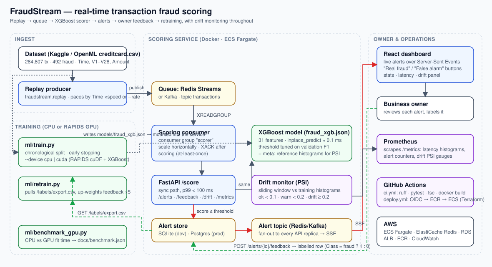
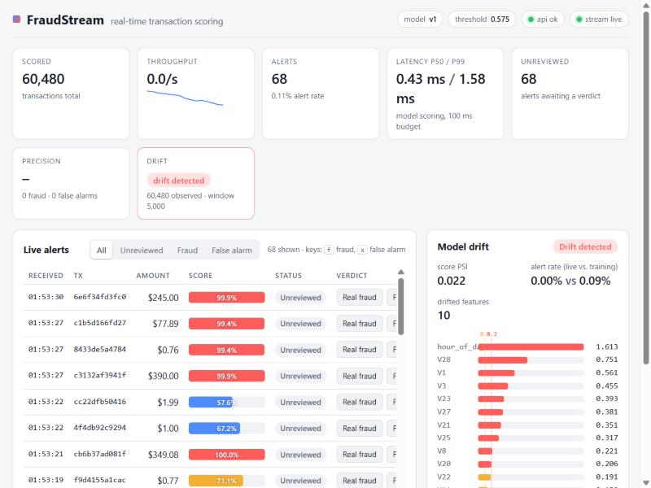

# FraudStream — real-time transaction fraud scoring

FraudStream scores every card transaction as it happens, raises an alert when a
transaction looks fraudulent, and lets the business owner confirm or dismiss each
alert from a live dashboard. Every verdict becomes a new labelled example, so the
model can be retrained as fraud patterns change — and a drift monitor tells you
*when* that retraining is due.



| | |
|---|---|
| **Data** | Public credit-card fraud dataset (Kaggle `mlg-ulb/creditcardfraud`, mirrored on OpenML): 284,807 transactions, 492 fraud (0.17 %). Replayed as a live stream paced by the dataset's own timestamps. |
| **Queue** | Redis Streams by default (consumer groups, acks, horizontal scaling). Kafka with one env var. In-memory backend for tests and laptops. |
| **Model** | XGBoost (31 features), chronological train/validation/test split, threshold tuned on validation. Trains on CPU or GPU (RAPIDS). |
| **Serving** | FastAPI. `POST /score` answers in ~1 ms server-side, p99 ≈ 10 ms end-to-end under 8 concurrent clients (budget: 100 ms). |
| **Dashboard** | React + Vite. Live alerts over Server-Sent Events, "Real fraud" / "False alarm" buttons, stats, latency, drift panel. |
| **Feedback loop** | Verdicts are stored and exported as training rows; `ml/retrain.py` folds them into the next model version. |
| **Drift** | Population Stability Index per feature and on the score distribution, sliding window, Prometheus gauges + `/drift`. |
| **Ops** | Docker Compose stack, GitHub Actions CI (ruff, pytest, tsc, image builds) and tag-triggered deploy to AWS ECS Fargate via OIDC, Terraform for the infrastructure. |



---

## 1. Quick start

### Option A — Docker (full stack: Redis, Postgres, API, 2 consumers, replay, dashboard, Prometheus)

```bash
git clone <this repo> && cd fraudstream
sh scripts/download_data.sh                      # -> data/creditcard.csv (≈150 MB, from OpenML)
cp .env.example .env
docker compose --profile train run --rm train    # trains the model once -> models/fraud_xgb.json
docker compose up --build                        # everything else
```

* Dashboard: <http://localhost:3000>
* API docs (OpenAPI): <http://localhost:8000/docs>
* Prometheus: <http://localhost:9090>

Scale the scorers with `docker compose up --scale consumer=4`. Swap the broker to
Kafka with `docker compose -f docker-compose.yml -f docker-compose.kafka.yml up`.

**Skip training:** the model trained for the results below is published as a
GitHub release. Download its three files into `models/` and skip the train step:

```bash
gh release download model-v1 --dir models
```

### Option B — no Docker (laptop / Windows)

```bash
python -m venv .venv && .venv/Scripts/activate            # or source .venv/bin/activate
pip install -e "backend[dev]"
sh scripts/download_data.sh                                # or: python -m fraudstream.synthetic --out data/creditcard.csv
cd backend
python -m ml.train --data ../data/creditcard.csv --out-dir ../models
python -m fraudstream.demo --data ../data/creditcard.csv --speed 300 --offset 227846
```

`fraudstream.demo` runs the API, the scoring consumer and the replay producer in
one process on the in-memory queue. `--offset 227846` skips the 80 % of rows the
model was trained on, so the stream contains only unseen transactions.
Then, in another terminal:

```bash
cd dashboard && npm install && npm run dev     # http://localhost:5173 (proxies /api -> :8000)
```

### Show it to someone (temporary public link, no cloud account)

```bash
.\scripts\demo.ps1
```

Starts the Docker stack if needed, opens a free Cloudflare quick tunnel to the
dashboard, and prints an `https://….trycloudflare.com` link. Share the link and
the login (`DASHBOARD_USER` / `DASHBOARD_PASSWORD` from `.env`; the script
refuses to open a tunnel without a password). The link lives only while that
window is open; `Ctrl+C` ends it, the local stack keeps running. Add `-Fresh`
to wipe stored alerts first for a clean demo. Requires
`winget install -e --id Cloudflare.cloudflared` once.

### Try the API directly

```bash
sh scripts/smoke.sh                                             # /health + one scored transaction
python scripts/latency_check.py --n 2000 --concurrency 8        # p50/p95/p99 report
curl http://localhost:8000/stats
curl http://localhost:8000/drift
curl -X POST http://localhost:8000/alerts/1/feedback -H 'content-type: application/json' -d '{"label":"fraud"}'
curl http://localhost:8000/labels/export.csv                    # feedback as training rows
```

---

## 2. Results

All numbers below were measured on this repository's code on a laptop (Intel
Core i7, 8 logical cores, no GPU, Windows 11, Python 3.12, XGBoost 3.4).

### Model quality (`models/fraud_xgb.metrics.json`)

Chronological split: train = first 70 % of the timeline, validation = next 10 %,
test = last 20 % (56,961 transactions, 75 fraud). Nothing from the future leaks
into training.

| Split | PR-AUC | ROC-AUC | Precision | Recall | Alerts raised |
|---|---:|---:|---:|---:|---:|
| Validation (threshold tuned here) | 0.834 | 0.987 | 0.963 | 0.788 | 27 / 28,480 |
| **Test (unseen, later in time)** | **0.810** | **0.988** | **0.838** | **0.760** | 68 / 56,961 |

Threshold 0.575 (max-F1 on validation), 299 boosting rounds (early stopping),
8.8 s to fit on CPU. PR-AUC is the headline metric: with 0.17 % positives,
accuracy and ROC-AUC alone are misleading.

### Scoring latency (`scripts/latency_check.py`, model loaded, SQLite alert store)

| Load | Client-observed p50 | p95 | p99 | Throughput | Model-only p99 |
|---|---:|---:|---:|---:|---:|
| 1 client, 1,000 requests | 0.90 ms | 1.85 ms | 2.31 ms | 879 req/s | 1.18 ms |
| 8 clients, 2,000 requests | 6.60 ms | 8.85 ms | **10.2 ms** | 1,144 req/s | 1.14 ms |

The single uvicorn worker stays ~10× inside the 100 ms budget. "Model-only" is
feature build + `inplace_predict`; the rest is HTTP, validation and bookkeeping.
Queue path: the in-process demo scored the 56,961-row test split at ~650 tx/s
while serving HTTP at the same time.

### GPU (RAPIDS) training benchmark (`ml/benchmark_gpu.py`, 300 rounds)

| Rows | CPU fit (s) | GPU fit (s) | Speed-up |
|---:|---:|---:|---:|
| 284,807 | 4.47 | *run on a GPU host* | – |
| 1,139,228 (dataset ×4) | 21.92 | *run on a GPU host* | – |

This machine has no NVIDIA GPU, so only the CPU column is filled
(`docs/benchmark.json`). The GPU column is produced by the same script inside
the RAPIDS image — it loads the CSV with cuDF, builds the features on the
device, and trains with `device="cuda"`:

```bash
make benchmark-gpu          # builds backend/Dockerfile.gpu and runs it with --gpus all
# or, on a host with RAPIDS installed:
cd backend && python -m ml.benchmark_gpu --data ../data/creditcard.csv --rounds 300 --replicate 1 4 16
```

The script prints the Markdown table above with the speed-up filled in and
rewrites `docs/benchmark.json`. It refuses to report a "GPU" number when XGBoost
silently fell back to CPU (it checks for that warning), so the speed-up it prints
is real. Expect the gain to grow with `--replicate`: on this 285k-row dataset a
mid-range GPU typically fits in well under a second versus ~4.5 s on CPU, and the
gap widens at millions of rows, which is where RAPIDS pays off.

---

## 3. How it works

### Stream replay
`fraudstream.replay` reads the CSV, sorts by `Time`, and publishes one
`Transaction` per row to the `transactions` topic. Pacing follows the dataset
(`--speed 120` = two dataset minutes per wall-clock second) or a fixed `--rate`.
Ground-truth labels travel along as `true_label` so the dashboard can show them
after the fact; the scorer never reads them.

### Queue
`fraudstream/queue/` defines one interface with two consumption styles:

* `consume(topic, group, consumer)` — work sharing. Each message goes to exactly
  one scorer in the group and is acked after the score (and alert) is persisted.
  Redis Streams (`XREADGROUP`/`XACK`) and Kafka (consumer group, manual commits)
  both give at-least-once delivery; the consumer re-reads its own unacked
  messages on restart.
* `subscribe(topic)` — fan-out. Every API replica mirrors the `alerts` topic to
  its connected dashboards over SSE, so there are no sticky sessions.

`FS_QUEUE_BACKEND=memory|redis|kafka` selects the implementation.

### Features and model
`fraudstream/features.py` is the single source of truth for both training and
serving: `V1..V28`, `Amount`, `log1p(Amount)`, hour of day. A test asserts the
online and offline paths produce identical vectors. `ml/train.py` uses a
chronological split, `scale_pos_weight = sqrt(neg/pos)`, early stopping on
PR-AUC, and picks the threshold that maximises F1 on validation (optionally with
a precision floor via `--min-precision`). The artifact is the booster JSON plus a
metadata file with the threshold, metrics and the reference histograms the drift
monitor needs.

### Scoring service
`POST /score` runs the whole pipeline synchronously and returns
`{score, is_alert, threshold, model_version, latency_ms}`. The queue consumer
runs the same `ScoringPipeline` (`fraudstream/scoring.py`). Alerts are written
to the store (SQLite locally, Postgres in Docker/AWS) and published to the
`alerts` topic. `FS_RUN_CONSUMER=true` runs the consumer inside the API process
(used on ECS so each task both serves and scores); `fraudstream-consumer` runs
it standalone for independent scaling.

### Dashboard and feedback
The React app (`dashboard/`) opens `GET /alerts/stream` (SSE) and prepends
alerts as they arrive. Each row has **Real fraud** / **False alarm** buttons that
call `POST /alerts/{id}/feedback`; verdicts can be changed, filtered, and the
owner can expand a row to see the feature values. Keyboard: `f` / `x` on the
selected row.

### Retraining with feedback
```bash
cd backend
python -m ml.retrain --api http://localhost:8000 --data ../data/creditcard.csv --out-dir ../models
```
pulls `GET /labels/export.csv` (one row per reviewed alert, in the dataset's
schema with `Class` = 1 for fraud, 0 for false alarm), merges it with the base
data with a 5× sample weight, trains a new version, writes new metrics, and
refuses to run with fewer than `--min-feedback` labels. Restart the API/consumer
(or roll the ECS service) to promote the new artifact.

### Drift monitoring
`fraudstream/drift.py` keeps a sliding window (default 5,000) of live values for
every feature and for the score, and compares each to the training-time histogram
with the Population Stability Index:

| PSI | Meaning |
|---|---|
| < 0.1 | stable |
| 0.1 – 0.2 | moderate shift — watch |
| ≥ 0.2 | significant shift — investigate / retrain |

`GET /drift` returns the per-feature report; `/metrics` exposes
`fraudstream_drift_psi{feature=…}` and `fraudstream_drift_status` for Prometheus
(`monitoring/alerts.yml` has ready-made alert rules for drift, p99 > 100 ms,
alert-rate spikes and consumer lag). In the demo above you can watch it work:
replaying only the last 20 % of the dataset makes `hour_of_day` drift
immediately (the window covers a few hours vs. two full days of training data),
and the random-feature traffic from `latency_check.py` lights up `V27`/`V28`.

---

## 4. Tests and CI

```bash
cd backend && pytest -q          # 36 tests, ~5 s, no services required
ruff check . && ruff format --check .
cd ../dashboard && npm run typecheck && npm run build
```

The suite trains a small model on synthetic data (same schema as the real set)
and covers: feature parity online/offline, model artifact round-trip and
single-row latency, PSI maths and the drift monitor's state machine, the
in-memory and Redis-Streams queues (via `fakeredis`, including redelivery of
unacked messages), the replay pacing, an end-to-end queue → consumer → alert
run, and the HTTP API (scoring under 100 ms, alert + feedback flow, CSV export,
SSE delivery, validation errors, metrics). Tests marked `redis` run against a
real server when `FS_REDIS_URL` is set — CI does that with a service container.

`.github/workflows/ci.yml` runs on every push/PR: backend lint + tests with
coverage, the Redis integration job, dashboard typecheck + build, Docker image
builds (no push), and `terraform fmt`/`validate`.

## 5. Deploying to AWS

`infra/terraform/` provisions ECR, an ECS Fargate cluster with Service Connect,
an ALB, ElastiCache Redis, RDS Postgres (DSN in Secrets Manager), a versioned S3
bucket for model artifacts, IAM roles and the GitHub OIDC deploy role. See
[infra/README.md](infra/README.md) for `terraform apply` steps and the GitHub
variables to set (`AWS_DEPLOY_ROLE_ARN`, `ECS_CLUSTER`, `MODEL_BUCKET`, …).

`.github/workflows/deploy.yml` runs on `v*` tags or manual dispatch: assumes the
role via OIDC, pulls the model from S3, builds and pushes the API and dashboard
images to ECR, renders the ECS task definitions and deploys both services,
waits for stability, then runs `scripts/smoke.sh` against the load balancer.

## 6. Repository layout

```
backend/
  fraudstream/        package: config, schemas, features, model, drift, store, metrics
    queue/            memory | redis_stream | kafka backends behind one interface
    api.py            FastAPI app          consumer.py   queue worker
    replay.py         stream producer      demo.py       single-process demo
  ml/                 train.py · retrain.py · benchmark_gpu.py · data.py
  tests/              pytest suite (synthetic data, fakeredis, TestClient)
  Dockerfile          python:3.12-slim service image
  Dockerfile.gpu      RAPIDS image for GPU training / benchmark
dashboard/            React + Vite + TypeScript, nginx.conf for Docker
docker-compose.yml    local stack (+ docker-compose.kafka.yml override)
.github/workflows/    ci.yml · deploy.yml
infra/                terraform/ · ecs/ task definitions
monitoring/           prometheus.yml · alerts.yml
scripts/              download_data.sh · smoke.sh · latency_check.py
docs/                 architecture.svg/.md · benchmark.json · dashboard.jpg
data/, models/        dataset and trained artifacts (git-ignored)
```

## 7. Configuration

Every backend setting is an environment variable prefixed `FS_` (see
`backend/fraudstream/config.py` and `.env.example`). The ones you will touch:

| Variable | Default | Purpose |
|---|---|---|
| `FS_QUEUE_BACKEND` | `redis` | `memory`, `redis` or `kafka` |
| `FS_REDIS_URL` / `FS_KAFKA_BOOTSTRAP` | `redis://localhost:6379/0` / `localhost:9092` | broker address |
| `FS_MODEL_DIR`, `FS_MODEL_NAME` | `../models`, `fraud_xgb` | which artifact to load |
| `FS_ALERT_THRESHOLD` | from model meta | override the decision threshold |
| `FS_DATABASE_URL` | `sqlite:///./fraudstream.db` | alert store (`postgresql+psycopg://…` in prod) |
| `FS_RUN_CONSUMER` | `false` | score from the queue inside the API process |
| `FS_DRIFT_WINDOW`, `FS_DRIFT_PSI_WARN`, `FS_DRIFT_PSI_ALERT` | `5000`, `0.1`, `0.2` | drift sensitivity |

## 8. Known limits and next steps

* **At-least-once, not exactly-once.** A crash between persisting an alert and
  acking the message can duplicate one alert row; add a unique index on `tx_id`
  if that matters for your downstream.
* **Single-model serving.** Promotion is "write new artifact, restart". A model
  registry and shadow-scoring a candidate against live traffic are the natural
  next steps; the `model_version` field is already on every alert.
* **PSI needs volume.** The monitor reports `insufficient_data` until 200
  observations; tune `FS_DRIFT_WINDOW` to your traffic.
* **The dataset's features are PCA components**, so the dashboard cannot explain
  *why* a transaction scored high in business terms. With raw features, SHAP
  values per alert would slot into the expandable row.
