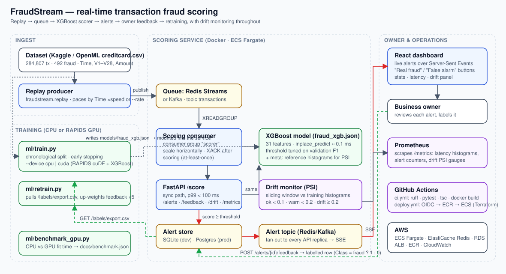
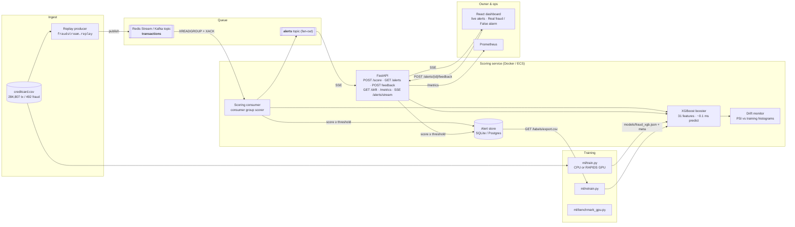

# Architecture

## Data flow

## Components

| Component | Module | Responsibility |
|---|---|---|
| Replay producer | `backend/fraudstream/replay.py` | Reads the labelled dataset and publishes each row as a `Transaction`, paced by the dataset's `Time` column (`--speed`) or at a fixed `--rate`. Ground-truth labels ride along as `true_label` but are never used for scoring. |
| Queue | `backend/fraudstream/queue/` | One interface, three backends: `memory` (tests / single process), `redis` (Redis Streams with consumer groups, the default), `kafka` (aiokafka). Work-sharing `consume()` + fan-out `subscribe()`. |
| Scoring consumer | `backend/fraudstream/consumer.py` | Pulls from the `transactions` topic in consumer group `scorer`, scores, acks. Any number of replicas share the work. |
| Model | `backend/fraudstream/model.py` + `models/fraud_xgb.json` | XGBoost booster + metadata (threshold, feature list, metrics, reference histograms). `inplace_predict` on a single float32 row. |
| Features | `backend/fraudstream/features.py` | One code path for training and serving: V1..V28, Amount, log(Amount+1), hour of day. |
| API | `backend/fraudstream/api.py` | Synchronous `/score`, async `/transactions`, alert CRUD + feedback, SSE stream, `/stats`, `/drift`, `/metrics`, `/labels/export.csv`. |
| Alert store | `backend/fraudstream/store.py` | SQLAlchemy; SQLite for dev, Postgres in Docker/AWS. Feedback rows become labelled training data. |
| Drift monitor | `backend/fraudstream/drift.py` | Sliding-window Population Stability Index for every feature and for the score distribution; exposed on `/drift` and as Prometheus gauges. |
| Dashboard | `dashboard/` | React + Vite. Live alert feed over SSE, feedback buttons, stats tiles, drift panel. nginx proxies `/api` to the API. |
| Training | `backend/ml/train.py`, `retrain.py`, `benchmark_gpu.py` | Chronological split, early stopping, threshold search, reference histograms. GPU via `--device cuda` (RAPIDS image). |
| Packaging / CI / infra | `docker-compose.yml`, `.github/workflows/`, `infra/terraform/` | Local stack, CI (lint, tests, build), tag-triggered deploy to ECS Fargate via OIDC. |

## Latency budget for `POST /score`

| Step | Typical |
|---|---|
| JSON parse + pydantic validation | ~0.2 ms |
| Feature vector build (numpy) | ~0.02 ms |
| XGBoost `inplace_predict` (single row, 1 thread) | ~0.1 ms |
| Drift window + metrics bookkeeping | ~0.05 ms |
| Alert persist (only when score ≥ threshold; off the event loop via a thread) | 1–5 ms |
| HTTP overhead (uvicorn, same host) | ~1 ms |

The sync path stays far below the 100 ms target; the queue path adds only broker round-trip time (sub-millisecond on a local Redis).

## Delivery guarantees

* Redis Streams / Kafka give **at-least-once** delivery: a consumer acks only after the score (and alert, if any) is persisted. A crash between persist and ack can produce a duplicate alert row for the same `tx_id`; the dashboard dedupes on `tx_id` and a unique index can be added if exactly-once semantics are needed.
* Alerts are also published to the `alerts` topic so every API replica can stream them to connected dashboards without sticky sessions.

## Retraining loop

1. Owner marks alerts in the dashboard → `POST /alerts/{id}/feedback`.
2. `GET /labels/export.csv` returns those rows in the dataset's schema with `Class` = 1 (fraud) or 0 (false alarm).
3. `python -m ml.retrain` merges them into the base data (weighted ×5), trains a new version, writes new artifacts and metrics.
4. Restart the API/consumer (or roll the ECS service) to load the new model. Drift PSI resets against the new reference histograms.
